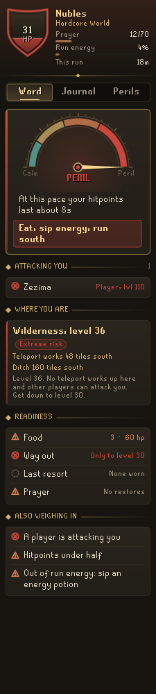
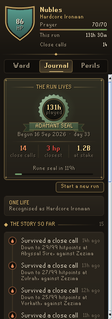
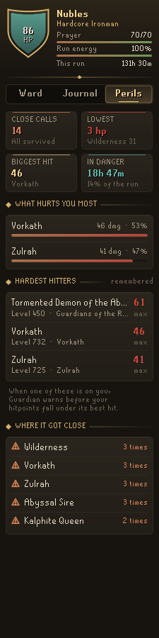
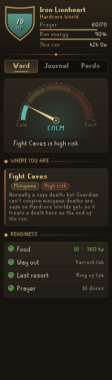
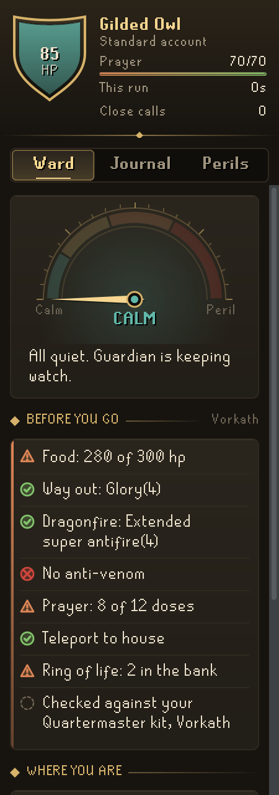
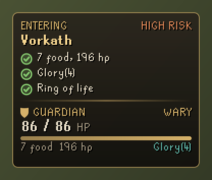
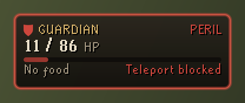
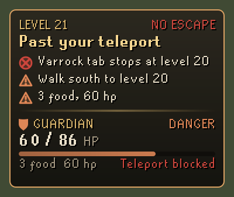
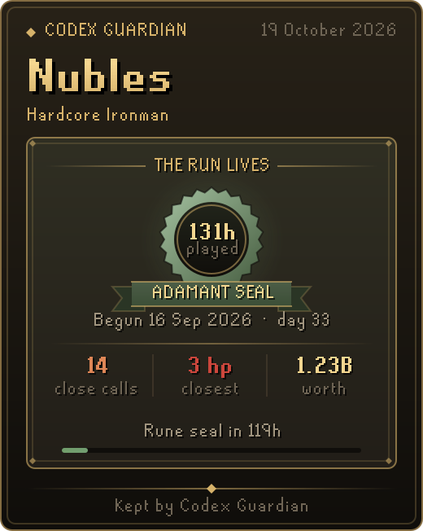

# Codex Guardian

**A companion for accounts with one life.** Codex Guardian watches over a Hardcore Ironman, a Hardcore Group Ironman, any account on a Hardcore World, or any account you mark as one-life. It tells you plainly how much danger you are in and what to do about it, checks your food and way out before you go, and keeps a journal of the run: every close call survived, every milestone, and what hurts you most.

Part of the **Codex** suite of RuneLite plugins, which share one look: warm ink, aged gold and the game's own fonts.

<p align="center">
  
  
  
</p>

## The panel

- **Ward.** A dial from Calm to Peril with the one reason that matters most and, in danger, the one thing to do now: teleport out with the item you carry, eat, walk south to a level your teleport works at, or run. Below it: who is attacking you, where you are and how risky it is, and your readiness (food, a way out, a last resort, prayer restores, cures). The crest at the top shows your hitpoints, prayer, run energy and how long the run has lasted.
- **Before you go.** Somewhere quiet, the Ward checks the trip ahead: food against what you plan to take, a way out, the protection your destination calls for (dragonfire, venom, a wyvern's breath and so on) and a last resort. No ring of life on, but two in the bank? It says so.
- **Journal.** The story of the run, newest first: close calls with how low you went, risky places entered, milestones, disconnects and lag in danger, a death or the loss of hardcore status (even one on another client, noticed at your next login). A death in a safe minigame is journaled as safe and does not end the run. Each close call and death has a replay of its last seconds: your hitpoints tick by tick, each hit, each bite of food and potion sip.
- **The run's seal.** The Journal opens on a seal earned by hours played on one life: bronze, iron at 5 h, steel 15, black 30, mithril 60, adamant 120, rune 250, dragon 500. It shows the day the run began, close calls survived, the closest of them, and your worth (with Codex Ledger). A fallen run keeps its seal, cracked.
- **Seal card.** **Save seal card** or **Copy** under the seal makes a picture of it to share.
- **Perils.** Close calls, your lowest hitpoints, the biggest hit taken, time spent in danger, what has dealt you the most damage and where it got close, and the monsters that have hit you hardest.

<p align="center">
  
  
</p>

## In the game

- **Plaque.** A small plaque with your hitpoints, food and way out, shown when you choose (always, or from Wary or Danger up).
- **Entry briefings.** Walk into a boss lair, a raid, a dangerous dungeon or the Wilderness and the plaque checks your food, teleport and ring of life before the first hit lands. Walk back into somewhere you nearly died and it says so: "2 close calls here, 6 hp low".
- **Wilderness sense.** Teleports are judged by level (most stop at 20, a glory and a few others at 30). Walk past your best teleport's reach and the plaque says so, with a notification, and counts the tiles back south to where it works again.
- **Peril.** When a death could come in the next few ticks (hitpoints critical under fire, one more hit like the worst you have taken from this monster would kill you, or your hitpoints run out within about twelve seconds at this pace) the plaque says what to do, the screen edge glows red and you get a notification.
- **Prayer and lag watch.** In a fight Guardian times how fast your prayer is falling and warns before it runs out, and it notices when game ticks arrive late while something can hurt you.

<p align="center">
  
  
  
</p>

<p align="center">
  
</p>

## Settings that matter

| Setting | Default | What it does |
| --- | --- | --- |
| Show plaque | Wary or worse | When the in-game plaque is shown. |
| Entry briefings | On | Checks food, way out and saving grace as you walk into a dangerous place. |
| Peril glow | On | The red glow at the edge of the game view while you are in peril. |
| Notify in peril, on low hitpoints, past teleport range, lag in danger | On | Notifications for each. "Notify on dangerous places" is off by default. |
| Food for danger | 80 | How many hitpoints of food Guardian wants you carrying into danger. |
| Close call at | 20% | How low your hitpoints must fall, and you survive, for a close call. |
| Name on cards | On | Your character's name on the seal card. |
| Worth on cards | Off | Your worth from Codex Ledger on the seal card; the seal in the panel shows it either way. |

## Hardcore Worlds and one-life accounts

Hardcore Ironmen and any account on a Hardcore World are recognised by themselves. Until their rules can be checked, Guardian does not take any minigame as safe on a Hardcore World: Fight Caves, the Inferno, the Colosseum, the Gauntlet, Pest Control and the rest read as a risk there. A death in one is journaled as an "Unconfirmed death"; if the game did end your run, **Mark as fallen** under that entry records it. For any other one-life account, press **Mark one-life** in the Journal tab. The choice belongs to that account alone.

## With other Codex plugins

Guardian works on its own. With these installed it knows more, and only ever reads what they save:

- **[Codex Quartermaster](https://github.com/Nubles/OSRS-Codex-Quartermaster):** the kit you chose there sets the trip check's destination, food and supplies. A kit counts only once you have chosen it.
- **[Codex Bank Steward](https://github.com/Nubles/OSRS-Codex-Bank-Steward):** your whole bank before you open it this session, so a forgotten teleport or anti-venom is named with what is waiting in the bank.
- **[Codex Ledger](https://github.com/Nubles/OSRS-Codex-Ledger):** your account's worth, for the seal.

[Codex Navigator](https://github.com/Nubles/OSRS-Codex-Navigator) reads the one-life choice you make here, to suggest safer quests first.

## Privacy and rules

Guardian only reads what the client already shows you: your stats, inventory and worn items, your position and who is attacking you. It warns about situations in general and never about what a particular boss is about to do. It does not click, change menus, send chat or touch the network. The journal and hit memory are saved per account in your RuneLite profile and never leave your computer. If a saved journal, hit memory or one-life choice is ever damaged, or holds something only a newer Guardian understands, Guardian keeps every part it can read and keeps the saved text aside (as `journalUnreadable`, `hitMemoryUnreadable` or `oneLifeAccountUnreadable`) rather than writing over it.

## Development

```bash
./gradlew build   # compile and run tests
./gradlew run     # launch RuneLite with the plugin loaded
```

The `docs/screenshots` images are rendered from the real panel and overlay code with a sample account.
