# Codex Guardian

**A companion for accounts with one life.** Codex Guardian watches over a Hardcore Ironman, a Hardcore Group Ironman, any account on a Hardcore World, or any account you mark as one-life. It tells you plainly how much danger you are in and what to do about it, checks your food and way out before you go, and keeps a journal of the run: every close call survived, every milestone, and what hurts you most.

Part of the **Codex** suite of RuneLite plugins, which share one look: warm ink, aged gold and the game's own fonts.

<p align="center">
  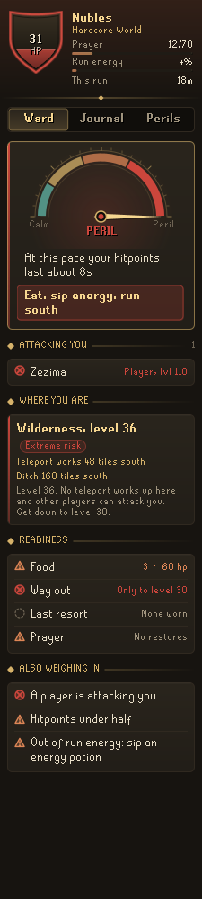
  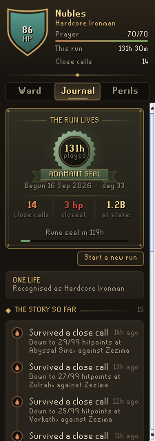
  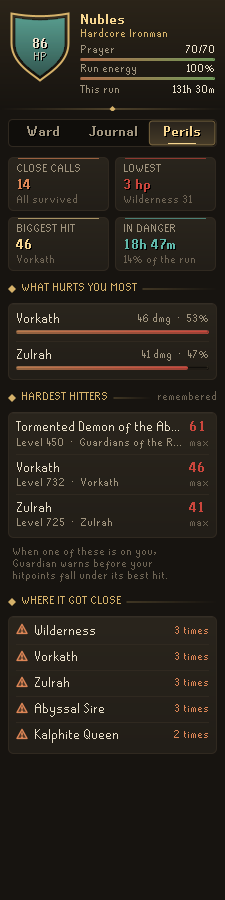
</p>

## The panel

- **Ward.** A dial from Calm to Peril with the one reason that matters most and, in danger, the one thing to do now: teleport out with the item you carry, eat, walk south to a level your teleport works at, or run. Below it: who is attacking you, where you are and how risky it is, and your readiness (food, a way out, a last resort, prayer restores, cures). The crest at the top shows your hitpoints, prayer, run energy and how long the run has lasted.
- **Before you go.** Somewhere quiet, the Ward checks the trip ahead: food against what you plan to take, a way out, the protection your destination calls for (dragonfire, venom, a wyvern's breath and so on) and a last resort. No ring of life on, but two in the bank? It says so.
- **Journal.** The story of the run, newest first: close calls with how low you went, risky places entered, milestones, disconnects and lag in danger, a death or the loss of hardcore status (even one on another client, noticed at your next login). A death in a safe minigame is journaled as safe and does not end the run. Each close call and death has a replay of its last seconds: your hitpoints tick by tick, each hit, each bite of food and potion sip.
- **The run's seal.** The Journal opens on a seal earned by hours played on one life: bronze, iron at 5 h, steel 15, black 30, mithril 60, adamant 120, rune 250, dragon 500. It shows the day the run began, close calls survived, the closest of them, and your worth (with Codex Ledger). A fallen run keeps its seal, cracked.
- **Seal card.** **Save seal card** or **Copy** under the seal makes a picture of it to share.
- **Perils.** Close calls, your lowest hitpoints, the biggest hit taken, time spent in danger, what has dealt you the most damage and where it got close, and the monsters that have hit you hardest.
- **Inquest.** Every death and close call taken apart afterwards, tick by tick. Guardian keeps the last half minute in full (hitpoints, prayer points and which protection prayer was on, each hit with who dealt it and whether the game showed it as a max hit, food and potions, teleport attempts, the Wilderness level, poison, venom, a freeze or a teleblock) and freezes it into an inquest when a close call ends or a death comes. The page shows:
  - a strip chart of hitpoints and prayer with every hit, lanes for protection prayers, food and teleports, and the worst tick of damage drawn as a line;
  - a plain verdict: "You took 47 in 3 ticks from 3 Ice troll runts with no protection prayer on; your last food was 9 ticks before.";
  - the tick it went past saving (for a death: hitpoints at or under the worst tick of damage, and no food eaten after it) or, for a close call, the brink;
  - what would have saved you, from your own readiness: food still in the pack, a teleport that worked where you stood (by the same Wilderness rules as the Ward), or one that did not reach, the protection prayers your Prayer level opens, and a last resort.

  It is read afterwards only: nothing on it runs during a fight, and it never says what to pray or where to stand. The last 20 inquests are kept per account.

<p align="center">
  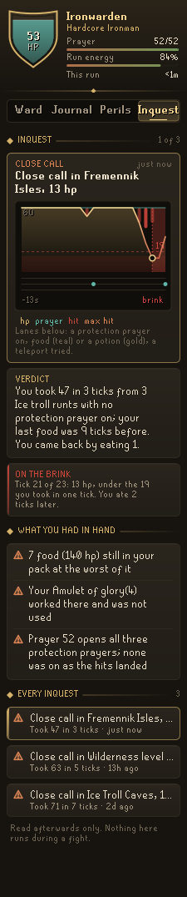
  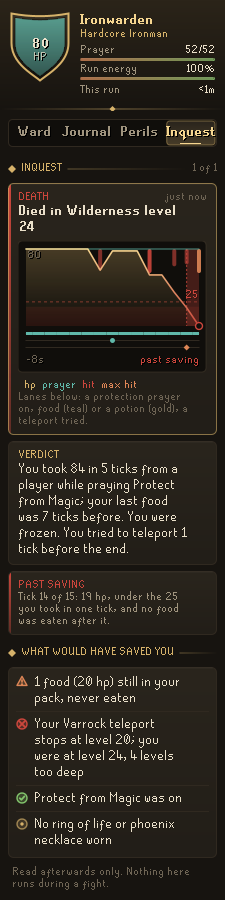
</p>

<p align="center">
  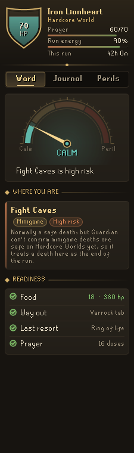
  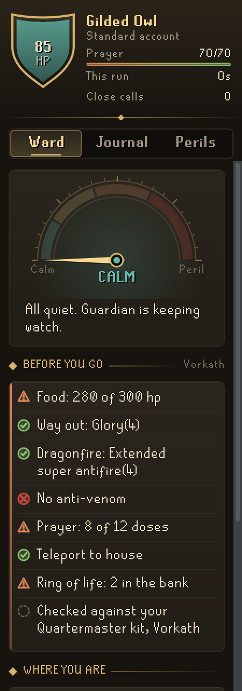
</p>

- **Watch.** Your own alarms, kept for this account (up to 12). Each rule has a trigger, what to do, and a rest before it may fire again:
  - **Triggers:** a game message that contains some words, or matches a pattern (a Java regex); a skill falling below a level (Hitpoints, Prayer or any other); run energy falling below a percentage; food falling below a number of pieces (food as Guardian reads your pack); an item's count falling below a number (a potion counts in every dose); a full backpack; standing idle for some seconds.
  - **Actions:** a RuneLite notification (with its own sound setting), and a flash at the edge of the game view in gold, teal, ember or blood with a small banner naming the rule. Guardian never writes in the game's chatbox; a rule saved by an older version that asked for a chat line now notifies instead.
  - A rule fires as its moment comes, not for as long as it lasts: prayer must have been above the number and fall below it. It then rests; if the moment comes again while it rests, it fires when the rest ends, provided it still holds. Only game messages are read, never anyone's chat.
  - Ready-made rules for what Guardian already watches: prayer running low, food running low, Tele Blocked, frozen, ring of life used, backpack full. Add one with a click and change it as you like.
  - **Try it** fires a rule once so you can see and hear it before you rely on it. A pattern that does not read is told in the editor and never saved; one that takes too long on a message is stopped after a fixed amount of work and paused, so a rule can never freeze the game.

<p align="center">
  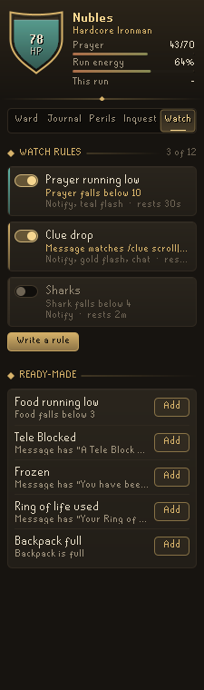
  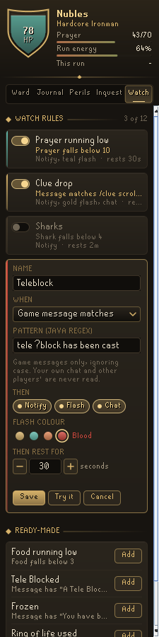
</p>

<p align="center">
  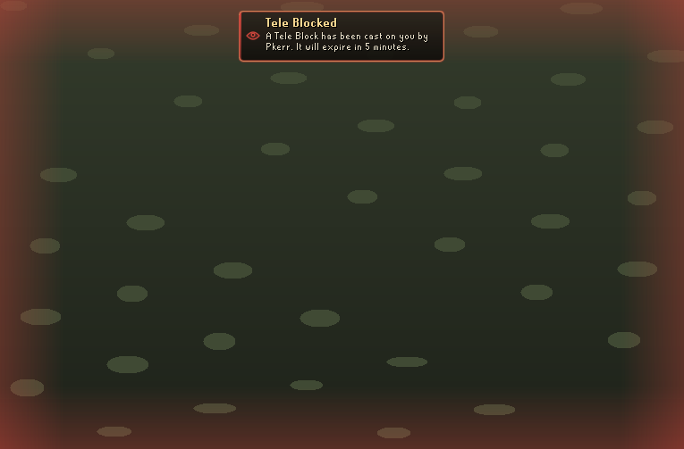
</p>

## In the game

- **Plaque.** A small plaque with your hitpoints, food and way out, shown when you choose (always, or from Wary or Danger up).
- **Entry briefings.** Walk into a boss lair, a raid, a dangerous dungeon or the Wilderness and the plaque checks your food, teleport and ring of life before the first hit lands. Walk back into somewhere you nearly died and it says so: "2 close calls here, 6 hp low".
- **Wilderness sense.** Teleports are judged by level (most stop at 20, a glory and a few others at 30). Walk past your best teleport's reach and the plaque says so, with a notification, and counts the tiles back south to where it works again.
- **PKer alarm.** In the Wilderness, and only there, the plaque names the players who can attack you right now: their combat level is inside your bracket at your Wilderness level, and yours inside theirs at the level they stand on. Players who cannot reach you, and your friends, clan and friends chat (a setting), never set it off. It grows stronger when they are skulled, wield a knock-out special (dragon dagger, claws, AGS, granite maul, Voidwaker, ancient godsword), step toward you, go for you, or come two at a time in multi, and says the one next move: "Teleport now: Glory works here", "Run 31 tiles south to level 30, then Glory", or, teleblocked, the tiles to the ditch. The screen edge flashes with a double beat, brighter on the side the player stands. A RuneLite notification, with your chosen sound, is off until you turn it on.
- **Peril.** When a death could come in the next few ticks (hitpoints critical under fire, one more hit like the worst you have taken from this monster would kill you, or your hitpoints run out within about twelve seconds at this pace) the plaque says what to do, the screen edge glows red and you get a notification.
- **Prayer and lag watch.** In a fight Guardian times how fast your prayer is falling and warns before it runs out, and it notices when game ticks arrive late while something can hurt you.

<p align="center">
  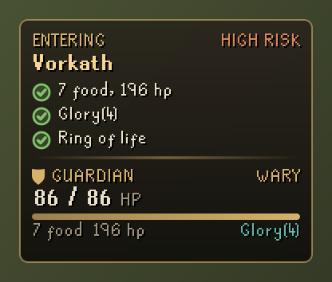
  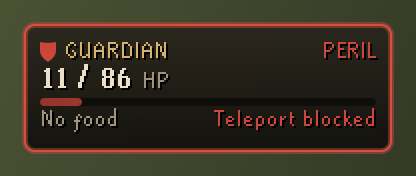
  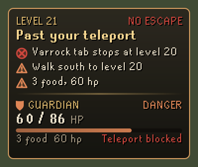
</p>

<p align="center">
  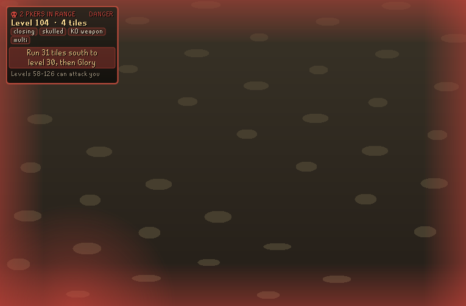
</p>

<p align="center">
  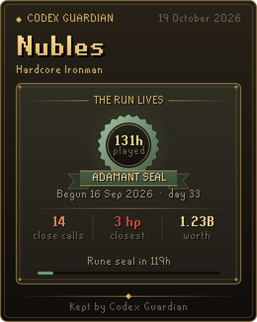
</p>

## Settings that matter

| Setting | Default | What it does |
| --- | --- | --- |
| Show plaque | Wary or worse | When the in-game plaque is shown. |
| Entry briefings | On | Checks food, way out and saving grace as you walk into a dangerous place. |
| Peril glow | On | The red glow at the edge of the game view while you are in peril. |
| PKer alarm, PKer screen flash | On | The Wilderness alarm on the plaque and at the screen edge. Off the Wilderness it never shows. |
| Trust friends and clan | On | Friends, clan mates and your friends chat never set off the PKer alarm. |
| PKer notification | Off | A RuneLite notification (sound, flash, tray) when a PKer comes into range or starts coming for you. |
| Notify in peril, on low hitpoints, past teleport range, lag in danger | On | Notifications for each. "Notify on dangerous places" is off by default. |
| Food for danger | 80 | How many hitpoints of food Guardian wants you carrying into danger. |
| Close call at | 20% | How low your hitpoints must fall, and you survive, for a close call. |
| Watch rules | On | Runs the alarms you write on the Watch page. You start with none; turned off, they are kept but none fire. |
| Watch rule notification | On | How a watch rule's notification reaches you: sound, tray message, window flash. |
| Name on cards | On | Your character's name on the seal card. |
| Worth on cards | Off | Your worth from Codex Ledger on the seal card; the seal in the panel shows it either way. |

## Hardcore Worlds and one-life accounts

Hardcore Ironmen and any account on a Hardcore World are recognised by themselves. For any other one-life account, press **Mark one-life** in the Journal tab. The choice belongs to that account alone.

On a Hardcore World, Guardian follows the mode's own death list from the wiki:

- **Safe, the run goes on:** capsizing your boat (no other death on it), Castle Wars, Clan Wars, Emir's Arena, Koschei's 4th phase in The Fremennik Trials, Last Man Standing, Pete Kayer's Challenges, the Galvek and Glough replays, Soul Wars, the TzHaar Fight Pit, and at Zulrah only the Elite Western Provinces resurrection.
- **Unsafe, the run ends:** Barbarian Assault, the Camelot training room, Chambers of Xeric, the Dream World in Lunar Diplomacy, Fishing Trawler, the Inferno, Magic Training Arena, Nightmare Zone, Pest Control, your player-owned house, the PvM Arena, the TzHaar Fight Cave (its elite diary resurrection is safe), random events and the Rogues' Den maze.
- **Not listed yet:** the Fortis Colosseum, the Gauntlet and Trouble Brewing are treated as unsafe.

Walk into a listed place and the plaque says so at the door ("Safe death here, even on a Hardcore World" or "This death ends your run"), the Ward's place card carries a **Safe death** or **Ends your run** pill, and on your boat it reads **Capsize only**. The Journal lists the whole ruleset under the account's mode.

**Reset or Transfer.** When a Hardcore World run falls, the Ward opens on a calm card before you choose in the game's own window. Two columns, side by side and in the same colours, because the card recommends nothing: **Reset** wipes your total level, quest points, bank (valued at Grand Exchange prices, from the bank as you last saw it or Codex Bank Steward's copy) and the protected items too, lets you start again as often as you like, and means 3 days without Stronghold of Security GP; **Transfer** keeps your protected items (named and valued, the three most valuable you carried, four with Protect Item) and your bank and storage, and leaves Hardcore Worlds for good. Under them: items bound for a gravestone are deleted either way, this life's hours, total level, seal and close calls, and how it ended. **See the inquest** opens the death's tick-by-tick inquest. The card stays until Guardian sees which way you chose (back on an ordinary world means Transfer; a lower total level on a Hardcore World means Reset), and **Hide** puts it away until the next login.

<p align="center">
  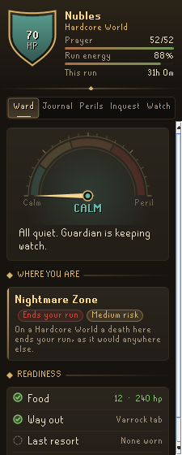
  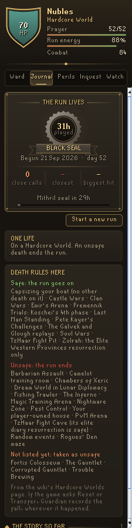
  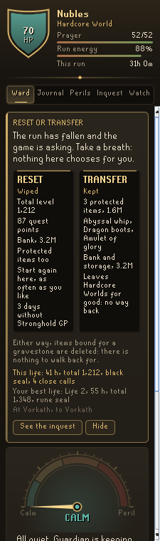
</p>

Where the place alone cannot tell (an unlisted minigame, a diary's resurrection, a boat), a death is journaled as an **Unconfirmed death**. When the game then asks you to Reset or Transfer, which it only does after a death that ended the run, Guardian records the fall by itself; if the run ended on another client, **Mark as fallen** under the entry does it.

## With other Codex plugins

Guardian works on its own. With these installed it knows more, and only ever reads what they save:

- **[Codex Quartermaster](https://github.com/Nubles/OSRS-Codex-Quartermaster):** the kit you chose there sets the trip check's destination, food and supplies. A kit counts only once you have chosen it.
- **[Codex Bank Steward](https://github.com/Nubles/OSRS-Codex-Bank-Steward):** your whole bank before you open it this session, so a forgotten teleport or anti-venom is named with what is waiting in the bank.
- **[Codex Ledger](https://github.com/Nubles/OSRS-Codex-Ledger):** your account's worth, for the seal.

[Codex Navigator](https://github.com/Nubles/OSRS-Codex-Navigator) reads the one-life choice you make here, to suggest safer quests first.

## Privacy and rules

Guardian only reads what the client already shows you: your stats, the protection prayers you have on, inventory and worn items, your position, who is attacking you, the combat level, skull, weapon and position of players near you in the Wilderness, the game's "You have been frozen!" line and which items you click to teleport (the click itself goes through untouched). It warns about situations in general and never about what a particular boss is about to do. It does not click, change menus, send or write chat, or touch the network. The journal, hit memory and inquests are saved per account in your RuneLite profile and never leave your computer. If a saved journal, hit memory or one-life choice is ever damaged, or holds something only a newer Guardian understands, Guardian keeps every part it can read and keeps the saved text aside (as `journalUnreadable`, `hitMemoryUnreadable`, `inquestsV1Unreadable` or `oneLifeAccountUnreadable`) rather than writing over it.

## Development

```bash
./gradlew build   # compile and run tests
./gradlew run     # launch RuneLite with the plugin loaded
```

The `docs/screenshots` images are rendered from the real panel and overlay code with a sample account.
